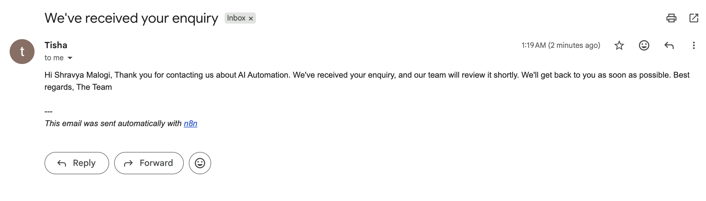
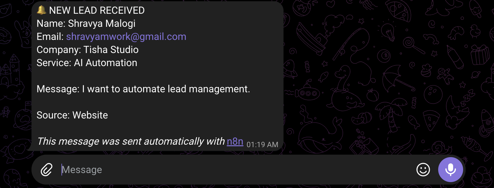

<div align="center">

# Lead Capture & CRM Sync Workflow

### Automated lead management using n8n, Google Sheets, Gmail, and Telegram

A workflow that captures leads, validates submitted information, syncs records to a Google Sheets CRM, sends notifications, and logs processing activity.


</div>

---

## 📌 Overview

Managing leads manually can result in scattered records, delayed responses, and inconsistent follow-ups. This project uses **n8n to automate the lead management process** by connecting a webhook with Google Sheets, Gmail, and Telegram.

When a lead is submitted, the workflow formats and validates the data. Valid leads are added to or updated in the CRM, followed by an email confirmation, a team notification, and an activity log entry. Invalid submissions are routed to a separate response path.

## ✨ Features

- **Webhook-based lead capture** — accepts lead details through an HTTP `POST` request.
- **Data formatting** — organizes incoming fields and normalizes email addresses.
- **Input validation** — checks that a name is provided and the email contains `@`.
- **CRM synchronization** — uses the email address to match existing records or add new leads in Google Sheets.
- **Automated email** — sends a confirmation through Gmail.
- **Team notifications** — sends lead notifications through Telegram.
- **Activity logging** — records workflow results in Google Sheets.
- **Invalid submission handling** — returns an HTTP `400` response for leads that fail validation.

## 🔄 How the Workflow Works

1. **Lead Webhook** receives a `POST` request containing lead information.
2. **Format Lead** prepares the submitted data and normalizes the email address.
3. **Validate Lead** checks the required name and basic email format.
4. **Upsert Lead CRM** adds or updates the lead in Google Sheets using email as the matching field.
5. **Send Confirmation** sends an email to the lead through Gmail.
6. **Notify Team** sends a notification to the configured Telegram chat.
7. **Log Result** records workflow activity in a Google Sheets log.

If validation fails, the lead follows the **Invalid Lead Response** path instead of continuing through the valid-lead route.

## 🖼️ Workflow Screenshots

The screenshots below show the workflow paths, Google Sheets records, notifications, and invalid-input handling.

### 1. Valid Lead Workflow

The workflow path for a lead that passes validation.


### 2. Alternative Workflow Path

A screenshot of the alternative execution path in the workflow.


### 3. Lead CRM — Google Sheets

The spreadsheet used to store lead details and match records by email address.


### 4. Activity Log — Google Sheets

The spreadsheet used to track workflow results.


### 5. Email Confirmation — Gmail

The confirmation email sent through Gmail as part of the automation.



### 6. Team Notification — Telegram

The Telegram message used to notify the team about a captured lead.



### 7. Invalid Lead Attempt

An example of an invalid submission and its handling by the workflow.


## 🧰 Technology Stack

| Technology | Purpose |
|---|---|
| **n8n** | Workflow orchestration and automation |
| **Webhooks / HTTP POST** | Receive lead submissions |
| **Google Sheets** | Store CRM records and activity logs |
| **Gmail** | Send lead confirmation emails |
| **Telegram Bot API** | Notify the team |
| **JSON** | Exchange structured data between workflow steps |

## ⚙️ Setup and Configuration

### Prerequisites

- A running n8n instance
- A Google account with access to Google Sheets and Gmail
- A Telegram bot created using [BotFather](https://t.me/BotFather)
- A Google spreadsheet with the required CRM and activity-log sheets
- The required credentials configured in n8n

### Import the Workflow

1. Download the workflow JSON file from this repository.
2. Open your n8n instance and import the JSON file.
3. Configure the Google Sheets, Gmail, and Telegram credentials.
4. Select the correct Google spreadsheet and sheet tabs in the relevant nodes.
5. Configure the Telegram chat ID and any other required values.
6. Confirm the webhook path is `lead-capture`.
7. Test the workflow with valid and invalid lead data before activating it.

> **Important:** An exported workflow does not include working account authorization. Configure your own credentials in n8n. If the shared JSON contains placeholder spreadsheet IDs or chat IDs, replace them with your own values after importing.

## 🧪 Test the Webhook

For a locally running n8n instance, send a sample valid lead using `curl`:

```bash
curl -X POST "http://localhost:5678/webhook/lead-capture" \
  -H "Content-Type: application/json" \
  -d '{
    "name": "Alex Johnson",
    "email": "alex@example.com"
  }'
```

Replace the URL with the webhook URL shown by your n8n instance.

**Expected behavior for valid data:** the workflow proceeds through the CRM and notification steps, provided the connected services and credentials are configured correctly.

**Expected behavior for invalid data:** a missing name or an email address without `@` is routed to the invalid-lead response, which returns HTTP `400`.

The email check is a basic validation rule; it does not guarantee that an address exists or can receive mail.

## 🔐 Security Notes

- Never commit API tokens, Telegram bot tokens, OAuth secrets, passwords, or access tokens.
- Use placeholders for private spreadsheet IDs and chat IDs in public examples.
- Use fictional sample leads in screenshots and test data.
- Hide personal information and sensitive configuration in screenshots.
- Store account credentials in n8n's credential manager rather than hardcoding secrets in workflow nodes.

## 🚀 Possible Improvements

- Add stronger email validation and input sanitization.
- Add retry logic and error handling for failed integrations.
- Record timestamps and more detailed execution statuses.
- Add lead status tracking and follow-up reminders.
- Build a dashboard to analyze lead volume and workflow performance.

## 📚 What This Project Demonstrates

This project provides hands-on experience with workflow automation, webhook integration, conditional routing, data validation, spreadsheet-based CRM operations, and connecting communication tools.

It demonstrates how several everyday services can be coordinated into a single automated lead management process.

---

<div align="center">

**Built by Shravya Malogi**  
Hyderabad, India

*Designed to explore practical workflow automation and service integration.*

</div>
